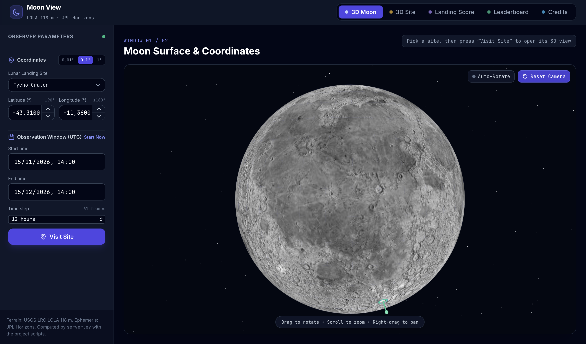

# Moon View

Moon View is an interactive site for exploring the Moon and comparing possible landing locations. It brings lunar terrain, sunlight, Earth and satellite visibility, and slope information together in one place. It is designed to be approachable for everyone: it can support an early, preliminary comparison of sites, while also giving space enthusiasts ways to explore the lunar surface and imagine what astronauts will experience when they will visit those sites.

The site also includes a **demo gamification concept**: landing-site scores and a leaderboard make it fun to compare locations and observation windows. These features are for exploration and illustration, not validated mission rankings or proof that a location is safe to land on.



**NOTE:** every script was made at least in part with the help of SI

## What you can do

- Explore the Moon in 3D, zoom in on a location, and inspect its terrain.
- Follow how sunlight, Earth, and a selected satellite appear from the surface over time.
- Compare visibility and terrain-slope assessments for one or two locations and time periods.
- Use the **Explore** tab for an immersive, first-person-style street-level view of a site.
- Try the demo leaderboard to compare scores; its player results are fictional and generated for demonstration.

## Run Moon View

You need Python 3 and an internet connection. From the project folder, install the packages listed in `requirement.txt`:

```bash
python -m pip install -r requirement.txt
```

Start the app:

```bash
python server.py
```

The app opens in your browser at <http://127.0.0.1:5050>. To start it without opening a browser automatically:

```bash
python server.py --no-browser
```

Choose a site or enter coordinates, then use the tabs and site controls to explore the terrain, visibility layers, and landing-site assessment. The first visit to an area may take longer because the app downloads elevation data; downloaded terrain is cached in `lunar_dems/` for later use.

## How it works

The app gets lunar elevation from the USGS Lunar Orbiter Laser Altimeter (LOLA) global map and uses JPL Horizons to find where the Sun, Earth, or a satellite appears in the lunar sky. It combines those positions with the local terrain to estimate shadows, line of sight, and the horizon.

The landing assessment summarizes how often each object is visible, how long the longest visibility and blackout periods are, and how much of the terrain is below a chosen slope limit. These are comparative estimates based on the selected time interval and map resolution, not certified landing-safety ratings. The leaderboard and example soil layers are illustrative rather than scientific measurements.

The main web app is served by `server.py`; `Lunar_Horizon_Simulator_Skeleton.html` provides its interface. Supporting scripts handle terrain and horizon views, sunlight, Earth visibility, satellite visibility, and ground-level views. Source credits are listed in [`sources.md`](sources.md) and on the app's Credits page.

## Sources

These are the sources credited by the project in [`sources.md`](sources.md):

- **Lunar ephemerides:** [JPL Horizons System](https://ssd.jpl.nasa.gov/horizons/)
- **Lunar topography:** [USGS Astrogeology Planetary Maps](https://planetarymaps.usgs.gov/) — including the global LOLA elevation map used by the app.
- **Notable lunar place names:** [USGS Gazetteer of Planetary Nomenclature](https://planetarynames.wr.usgs.gov/)
- **Apollo landing-site reference:** [LROC QuickMap](https://quickmap.lroc.asu.edu/)
- **Moon 3D visualization reference:** [NASA Eyes on the Solar System](https://eyes.nasa.gov/apps/solar-system/#/earth/moons/moon?embed=true)
- **Additional project reference:** [Space-Ros Curiosity rover demo](https://github.com/space-ros/demos/blob/main/curiosity_rover/)

The project also uses external browser resources for some page styling, fonts, and 3D rendering, so those parts may require an internet connection.
